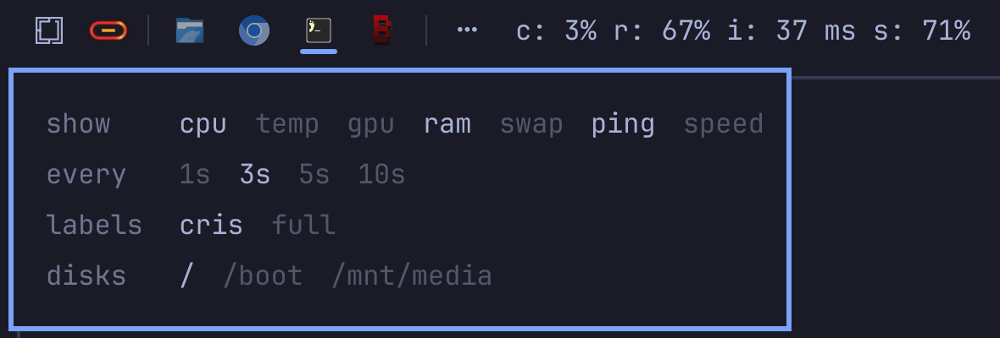

# CRIS

[](https://github.com/GreyforgeLabs/omarchy-cris/actions/workflows/test.yml)
[](https://github.com/GreyforgeLabs/omarchy-cris/releases/latest)
[](LICENSE)
[](https://omarchy.org)

**C**PU, **R**AM, **I**nternet, **S**torage, in one line of your Omarchy bar. The lightest system monitor on the planet: 16 KB of RAM and about a tenth of a millisecond of CPU per tick, [measured](#how-light) next to slstatus, top and btop.

<p align="center">
  
</p>

## Install

```sh
omarchy plugin add https://github.com/GreyforgeLabs/omarchy-cris --enable
```

CRIS appears in the left section of the bar. On first run it compiles its sampler with gcc into `~/.cache/omarchy-cris`; Omarchy ships gcc, and the bar tells you if yours is missing.

Click it for settings. Bright is on, dim is off:

<p align="center">
  
</p>

```text
show    cpu  temp  gpu  ram  swap  ping  speed
every   1s  3s  5s  10s
labels  cris  full                        full: cpu: 4% ram: 57% net: 24 ms disk: 75%
disks   /  /boot  /mnt/data               found automatically
```

## Why these four

- **cpu**: is the machine busy? One number for all cores.
- **ram**: real memory pressure (`MemTotal - MemAvailable`). Cache does not count as used.
- **internet**: latency, not bandwidth. Latency is what you feel in every page load, call, game and
  SSH session, and a ping shows a dead connection instantly. Want bandwidth anyway? Turn on speed.
- **storage**: space used. A full disk is the failure that silently breaks everything else.

## How light

|                                    | RAM       | CPU per 3 s tick  |
| ---------------------------------- | --------- | ----------------- |
| a program that only sleeps         | 12 KB     | ~60 µs            |
| **CRIS**                           | **16 KB** | **~70-120 µs**    |
| suckless slstatus (cpu, ram, disk) | 2,556 KB  | ~250 µs, no ping  |
| top (batch mode)                   | 6,100 KB  | ~11,000 µs        |
| btop                               | 32,188 KB |                   |

One 5 KB process per bar, with no libc and no environment: raw syscalls, files and socket opened once, one
wakeup per tick on an absolute monotonic deadline, nothing read that you did not turn on. If the process is ever
killed, the widget starts it again after 5 s, backing off to 5 min. The ping reply is timestamped by the kernel,
so it never wakes CRIS up. Measure it yourself: `tests/bench.sh` (the others were measured the same way, side by
side on the same machine, in September 2026).

x86-64 Linux.

## Troubleshooting

| The bar shows | What it means |
| ------------- | ------------- |
| `cris needs gcc: sudo pacman -S gcc` | No C compiler on `PATH`. Install gcc; CRIS builds itself on the next start. |
| `cris: build failed, retrying` | gcc is there but the build failed (wrong architecture, full disk, unwritable `~/.cache`). The widget retries after 5 s, then backs off to 5 min. |
| `…` | The first tick. CPU, ping and speed need two samples, so they fill in one interval later. |
| `n/a` | A sensor this machine does not have: CPU temperature, an amdgpu load counter, or a ping socket (`net.ipv4.ping_group_range` excludes your group). |
| `i: down` | The ping to 1.1.1.1 got no reply: the connection is down, or ICMP is blocked on this network. |

Changes to CRIS's code reach the bar after `omarchy restart shell`.

## Removal

```sh
omarchy plugin remove greyforge.cris
rm -f ~/.cache/omarchy-cris
```

## Development

`tests/check.sh` builds the sampler exactly as the widget does and checks every option, the error paths and the
launch line; CI runs it on every push. `tests/bench.sh` prints the footprint numbers above for your machine.

MIT © Greyforge Labs.

---

<p align="center">
  <b>Like it light?</b> <a href="https://github.com/GreyforgeLabs/omarchy-cris">Star CRIS on GitHub</a> · <a href="https://x.com/GreyforgeLabs">Follow @GreyforgeLabs</a> · <a href="https://greyforge.tech/open-source#cris">More Omarchy tools at greyforge.tech</a>
</p>

<p align="center"><sub><a href="https://x.com/GreyforgeLabs/status/2104939023513145412">CRIS announcement on X</a>, September 29, 2026</sub></p>
